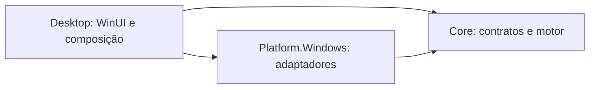

# Guia técnico — RM Auto Clicker

Referência da implementação atual. Para instruções de uso, consulte o [README](../README.md).

## Ambiente e ferramentas

| Item | Configuração |
| --- | --- |
| SDK .NET | `10.0.403`, fixado em [global.json](../global.json) |
| Resolução do SDK | `rollForward: disable`; previews desabilitadas |
| Runtime de referência do pacote | `.NET 10.0.14` |
| Interface | WinUI 3 / Windows App SDK `2.5.1` |
| MVVM | CommunityToolkit.Mvvm `8.4.2` |
| Desktop | `net10.0-windows10.0.19041.0`, `win-x64` |
| Plataforma mínima declarada no Desktop | `10.0.17763.0` |
| Scripts | PowerShell 7 no Windows |
| Solução | [RM.AutoClicker.slnx](../RM.AutoClicker.slnx) |
| Versão do produto | `1.0.0`, definida em [Directory.Build.props](../Directory.Build.props) |

Os pacotes diretos estão em [Directory.Packages.props](../Directory.Packages.props). Cada projeto mantém seu `packages.lock.json`. A primeira restauração requer acesso aos feeds NuGet; as compilações e os testes da solução devem ser executados no Windows.

### Compilar e testar

Execute na raiz do repositório, em um checkout com pelo menos um commit:

```powershell
dotnet --version
dotnet restore RM.AutoClicker.slnx --locked-mode
dotnet build RM.AutoClicker.slnx -c Release --no-restore -warnaserror
dotnet test RM.AutoClicker.slnx -c Release --no-build --no-restore
./tests/scripts/Test-ReleaseScripts.ps1
```

Os testes de origem da release consultam o `HEAD` local e exigem um commit válido. As chamadas ao GitHub são simuladas nos testes.

Ao atualizar SDK ou dependências:

```powershell
dotnet restore RM.AutoClicker.slnx --force-evaluate
dotnet restore RM.AutoClicker.slnx --locked-mode
```

Revise os lockfiles e execute build e testes antes de incluí-los na mesma alteração. O modo travado impede que o CI aceite silenciosamente outro grafo de dependências. O SDK permanece fixado, inclusive para novas feature bands do .NET 10.0; atualizações passam por revisão.

## Organização e dependências

| Projeto ou diretório | Responsabilidade |
| --- | --- |
| [Core](../src/RM.AutoClicker.Core) | Contratos, modelos imutáveis, validação, intervalos e execução da sessão; sem dependência de Windows ou WinUI |
| [Platform.Windows](../src/RM.AutoClicker.Platform.Windows) | `SendInput`, proteção de alvo, hotkeys, bandeja, notificações de sessão, instância única e persistência |
| [Desktop](../src/RM.AutoClicker.Desktop) | Aplicação WinUI, XAML, ViewModel, recursos de idioma, diagnósticos e composição dos serviços |
| [tests](../tests) | Testes .NET, auxiliares isolados e testes PowerShell |
| [scripts](../scripts) | Versão, publish, validação do pacote/origem, publicação remota, smoke e conversão do ícone |
| [assets/branding](../assets/branding) | PNG original, ICO utilizado pelo aplicativo e registro de geração da logo |
| `artifacts/` | Saídas locais e de CI; ignoradas pelo Git |



A composição é explícita em `App.xaml.cs` e `MainWindow.xaml.cs`, sem contêiner de injeção de dependências. O ViewModel recebe contratos como `IClickSessionController`, `ISettingsStore` e `IAppStrings`. Os adaptadores nativos têm interfaces internas substituíveis nos testes.

## Motor de cliques

[ClickSessionController](../src/RM.AutoClicker.Core/Execution/ClickSessionController.cs) executa uma única sessão em tarefa independente da UI. O plano é um `ClickPlan` imutável; editar o formulário durante a execução prepara a próxima sessão.

Estados: `Idle`, `Starting`, `Running`, `Stopping`, `Faulted` e `Disposed`.

Invariantes:

- `Start` valida o plano e só aceita uma sessão quando o estado é `Idle` e o worker anterior terminou.
- `StopAsync` cancela o worker e retorna sua tarefa. A conclusão inclui a limpeza da entrada pendente.
- `DisposeAsync` coordena parada e liberação final; chamadas concorrentes compartilham a mesma operação de descarte.
- O `ExecutionSnapshot` é obtido sob lock. O tempo usa timestamps monotônicos de `TimeProvider`, que pode ser substituído nos testes.
- O agendamento usa `Task.Delay`; não há espera ocupada. Se o envio atrasar além do próximo horário, o motor agenda outro intervalo sem emitir uma rajada para compensar.
- O contador só avança para cliques completos enviados. Supressão de alvo não conta como clique nem como erro.
- O limite de duração continua sendo contado durante a supressão. Entre duração e quantidade, vale o primeiro limite alcançado.
- Uma falha coloca a sessão em `Faulted`. `ResetFault` tenta liberar a entrada antes de permitir outra execução.

A política de intervalo usa:

```text
base = 1 / cliquesPorSegundo
intervalo = base × (1 + (2 × amostra - 1) × variação / 100)
```

A amostra aleatória deve ser finita e estar entre 0 e 1. A variação é simétrica sobre o intervalo, e não uma garantia de variação simétrica da taxa observada. A taxa enviada mede eventos inseridos no Windows; não confirma processamento no aplicativo de destino.

### Limites de configuração

| Campo | Validação do motor | Validação adicional da UI |
| --- | --- | --- |
| Velocidade | Finita, de 1 a 100 cliques/s | Mesma faixa |
| Variação | Finita, de 0 a 50% | Mesma faixa |
| Botão | Valor definido em `ClickButton` | Esquerdo, direito ou meio |
| Atraso | De 0 a 300 segundos | Quando habilitado, de 0,1 a 300 segundos |
| Quantidade máxima | Inteiro positivo, quando definido | Até 1.000.000.000 |
| Duração máxima | Positiva, quando definida | De 0,1 a 86.400 segundos |

Por padrão, a velocidade é 10 cliques/s, o botão é o esquerdo, não há variação, atraso nem limites habilitados.

## Integração com Windows

### Entrada e proteção da janela

[WindowsInputEmitter](../src/RM.AutoClicker.Platform.Windows/Input/WindowsInputEmitter.cs) usa `SendInput` para inserir um par down/up do botão escolhido, sem mover o cursor. O resultado registra quantidade solicitada, quantidade inserida e código de erro.

Se apenas o down for inserido, o emissor mantém a soltura pendente. O motor tenta liberá-la ao encerrar; uma falha de liberação recebe nova tentativa limitada no descarte e é reportada.

[WindowsClickTargetGuard](../src/RM.AutoClicker.Platform.Windows/Input/WindowsClickTargetGuard.cs) verifica a janela sob o cursor, seu proprietário raiz e a captura do mouse. Janelas do próprio processo e estados em que não é possível identificar o alvo bloqueiam o clique. A captura evita cliques nas próprias configurações durante arrastes.

O manifesto usa `asInvoker`, `uiAccess=false` e DPI `PerMonitorV2`. Não há mecanismo para contornar restrições de entrada impostas pelo Windows ou pelo processo de destino.

### Atalhos e bandeja

[WindowIntegration](../src/RM.AutoClicker.Platform.Windows/Hotkeys/WindowIntegration.cs) integra o HWND usando subclassing. As hotkeys usam `RegisterHotKey` com `MOD_NOREPEAT`.

- Alternância padrão: F8, `VirtualKey=0x77`.
- Emergência fixa: Ctrl+Shift+F10, `VirtualKey=0x79`.
- Modificadores: Alt = 1, Control = 2, Shift = 4. Combinações usam OR desses valores.
- Teclas modificadoras isoladas, combinações com Windows, F12, a emergência e sequências reservadas são rejeitadas.
- A validação final de disponibilidade é feita pelo registro no Windows. Uma troca malsucedida mantém o atalho anterior.
- A captura de um novo atalho não inicia uma sessão e só aplica o candidato após confirmação.
- Falhas no registro das proteções necessárias impedem o início.

A bandeja usa `Shell_NotifyIcon`. O tooltip contém o nome do aplicativo e o atalho configurado, no formato `RM Auto Clicker · F8`, com o recurso `TrayTip` presente nos três idiomas. Ao recriar o Explorer, a mensagem `TaskbarCreated` tenta restaurá-la. `AppSettings.MinimizeToTray` é persistido no schema 2 e assume `false` em arquivos existentes que não tenham o campo. O subclass de janela detecta a transição `WM_SIZE/SIZE_MINIMIZED` para cobrir o botão da barra de título, o apresentador e comandos do Windows; o handler é enfileirado após o processamento da mensagem e só oculta a janela se a preferência estiver ativa e ela continuar minimizada. A bandeja precisa estar disponível antes de ocultar; se não estiver, `ShowWindow(SW_RESTORE)` mantém a janela acessível na barra de tarefas. O duplo clique (`WM_LBUTTONDBLCLK`) e o item Abrir do menu restauram a janela. Suspensão, bloqueio e eventos relevantes de sessão solicitam parada.

### Instância e encerramento

[SingleInstanceGuard](../src/RM.AutoClicker.Platform.Windows/Lifecycle/SingleInstanceGuard.cs) usa um mutex `Local\\RMAutoClicker.<hash>`, derivado do domínio e nome do usuário. O escopo é a sessão Windows. Uma segunda abertura tenta restaurar a janela existente pelo título.

O fechamento cancela temporariamente a operação nativa, aguarda parada, salvamento e descarte do motor, remove integrações e então fecha a janela. Falhas na liberação final são registradas em log. Reabrir o programa sempre começa sem sessão ativa.

## Preferências e diagnósticos

### Arquivos locais

```text
%LOCALAPPDATA%\RM Corporation\RM Auto Clicker\
├── settings.json
└── logs\
    ├── app.jsonl
    └── app.jsonl.previous
```

[SettingsStore](../src/RM.AutoClicker.Platform.Windows/Persistence/SettingsStore.cs) serializa com `System.Text.Json`, nomes camelCase, propriedades lidas sem diferenciar maiúsculas/minúsculas e propriedades somente leitura excluídas.

Exemplo válido de preferências:

```json
{
  "schemaVersion": 2,
  "plan": {
    "clicksPerSecond": 10,
    "variationPercent": 0,
    "button": 0,
    "initialDelay": "00:00:00",
    "maximumClicks": null,
    "maximumDuration": null
  },
  "hotkey": {
    "virtualKey": 119,
    "modifiers": 0
  },
  "themeIndex": 0,
  "hasInitialDelay": false,
  "language": "auto"
}
```

`button`: 0 = esquerdo, 1 = direito, 2 = meio. `themeIndex`: 0 = sistema, 1 = claro, 2 = escuro. Idiomas aceitos: `auto`, `pt-BR`, `en-US` e `es`.

O schema 1 é convertido em memória: `hotkeyIndex` de 0 a 5 corresponde a F6–F11. A leitura não reescreve o arquivo; o schema 2 é gravado no próximo salvamento. Arquivos ausentes usam os padrões. Arquivos inválidos, ilegíveis ou com schema incompatível são preservados e deixam `CanSave=false` naquela execução.

O salvamento valida o modelo, usa `SemaphoreSlim`, escreve um arquivo temporário no mesmo diretório e substitui o destino com `File.Move`. O temporário é removido no `finally`. Essa sequência não deve ser descrita como garantia de durabilidade contra queda de energia.

Diretórios utilizados por versões anteriores não são migrados automaticamente. Para reaproveitar preferências, copie o `settings.json` com os aplicativos fechados, revisando um eventual arquivo no destino.

### Concorrência de preferências

O ViewModel possui uma fila de salvamento de idioma (`LanguageSaveTask`) e uma exclusão de salvamentos de preferências. `SaveAsync` aguarda o idioma antes de verificar a validade do restante do formulário. Assim, uma edição numérica inválida não faz o fechamento ignorar uma gravação de idioma ainda pendente.

Aplicar um atalho salva a escolha confirmada preservando o plano anteriormente salvo. Alterar idioma também não persiste campos numéricos inválidos.

### Logs

[AppDiagnostics](../src/RM.AutoClicker.Desktop/AppDiagnostics.cs) grava JSON Lines com `Timestamp` em UTC, `Event` e `Error`. Antes de uma nova gravação, um arquivo que exceda 1.048.576 bytes é movido para `app.jsonl.previous`, substituindo o anterior. O tamanho pode ultrapassar o limiar com a última entrada; não é um teto rígido por arquivo.

Falhas de I/O ou permissão no logger são encaminhadas para `Trace`. Os testes usam diretórios temporários ou coletores de diagnóstico por instância, sem depender dos arquivos reais do usuário.

## Interface e localização

### Dimensões e fluxo do layout

A janela abre em 760 × 650 e permite redimensionamento entre 400 × 600 e 900 × 900 unidades lógicas. Os limites são convertidos pelo DPI do HWND e reduzidos quando necessário para caber na área útil do monitor. A configuração é reavaliada no carregamento e nas mudanças de posição, apresentador ou escala da raiz XAML.

O `OverlappedPresenter` mantém `IsResizable=true` e `IsMaximizable=false`. Os limites são aplicados por `PreferredMinimumWidth/Height` e `PreferredMaximumWidth/Height`, que também restringem tentativas de `AppWindow.Resize`. A barra usa conteúdo WinUI estendido até o topo; uma região dedicada permite arrastar a janela e os botões localizados de minimizar e fechar substituem os controles nativos. A configuração usa `SetBorderAndTitleBar(true, false)` para manter a moldura de redimensionamento sem o título nativo. No Windows 11, [`DWMWA_BORDER_COLOR = DWMWA_COLOR_NONE`](https://learn.microsoft.com/en-us/windows/win32/api/dwmapi/ne-dwmapi-dwmwindowattribute) suprime apenas o contorno pintado pelo DWM; em alto contraste o contorno padrão do sistema é preservado. No Windows 10, a moldura padrão permanece. A altura medida da barra é descontada do viewport de configurações. [Referência Microsoft](https://learn.microsoft.com/pt-br/windows/apps/develop/ui/manage-app-windows) e [personalização da barra de título](https://learn.microsoft.com/pt-br/windows/apps/develop/title-bar).

O formulário usa linhas `Auto`, `Auto` e `*` em um Grid que preenche a área útil. O rodapé fica alinhado ao fim da última linha, com margem inferior fixa; a sobra de espaço permanece entre as configurações e as ações. O limite de altura do ScrollViewer central é calculado com a altura disponível, descontando cabeçalho, rodapé, margens, padding e espaçamentos. Os cards de status, configurações básicas e opções avançadas têm a mesma largura, sem recuo horizontal adicional no conteúdo rolável. O espaçamento entre esses cards é de 8; entre a linha de título/Preferências e o card de status é de 12. O padding inferior é de 18 e o afastamento mínimo do rodapé em relação às configurações é de 14, resultante da margem superior de 6 somada ao espaçamento de linha de 8. A legenda de emergência tem 4 de afastamento das ações, somando o espaçamento de 2 do rodapé e sua margem superior de 2. O cabeçalho das opções avançadas tem altura mínima de 60 e sua largura acompanha o formulário. O resumo das opções avançadas descreve os recursos disponíveis quando nenhuma opção está ativa e mostra os valores configurados quando há opções ativas, independentemente de erros nos campos básicos. Quando o conteúdo excede o espaço disponível, apenas as configurações rolam; cabeçalho e ações ficam acessíveis. A confirmação de salvamento fica abaixo do botão Salvar, alinhada à direita e na mesma linha da legenda de emergência em janelas largas. Em janelas estreitas, as legendas ocupam linhas separadas para preservar a leitura. O texto de salvamento tem truncamento visual, dica com o texto completo e `LiveSetting=Polite`.

A revelação das opções avançadas acompanha a medição e a posição do conteúdo até ficarem estáveis. A operação é assíncrona, limitada a dois segundos e encerrada ao recolher o menu, iniciar outra expansão ou fechar a janela. A rolagem posiciona a primeira opção no viewport sem redimensionar a janela.

### Campos e idiomas

O ViewModel usa propriedades e comandos gerados pelo CommunityToolkit.Mvvm. A janela atualiza a apresentação a cada 250 ms por `DispatcherQueueTimer`; essa frequência não determina a emissão dos cliques.

Os `NumberBox` usam a cultura regional para números. O texto ainda em edição é confirmado antes de iniciar por atalho; parar independe da validade do campo. [AutoDismissNumberBox](../src/RM.AutoClicker.Desktop/Controls/AutoDismissNumberBox.cs) fecha o popup de setas ao clicar fora, confirmando a edição. Evite substituir esse comportamento sem testar foco, valor vazio e reabertura no controle real.

Os recursos estão em `src/RM.AutoClicker.Desktop/Strings/{pt-BR,en-US,es}/Resources.resw`. XAML usa `x:Uid`; mensagens dinâmicas e bandeja recebem `IAppStrings`. Validações do domínio usam `UserMessageCode`, sem acoplar o motor a um idioma.

[MrtAppStrings](../src/RM.AutoClicker.Desktop/Localization/MrtAppStrings.cs) carrega os três catálogos do PRI antes de definir `ApplicationLanguages.PrimaryLanguageOverride`. Preserve essa ordem: o override global pode interferir em consultas a outros idiomas. As chaves e placeholders devem permanecer equivalentes nos três catálogos.

A preferência de idioma é independente da cultura numérica. Em modo automático, idiomas não suportados usam inglês. Após salvar outra preferência, a UI mostra o aviso dentro de Preferências. `RestartCommand` aguarda salvamentos, encerra a sessão, trata solturas pendentes e solicita `AppInstance.Restart`. O reinício só acontece por ação do usuário.

### Logo e ícones

A origem é [rm-auto-clicker-logo.png](../assets/branding/rm-auto-clicker-logo.png). Regeneração:

```powershell
./scripts/Convert-AppIcon.ps1
```

O script usa System.Drawing no Windows para criar [rm-auto-clicker.ico](../assets/branding/rm-auto-clicker.ico), com tamanhos 16, 20, 24, 32, 40, 48, 64, 128 e 256 e transparência.

`ApplicationIcon` inclui o recurso no executável. O mesmo arquivo é conteúdo vinculado como `Assets/App.ico`, copiado no build e no publish. `AppWindow.SetIcon` aplica o ícone extraído à janela; a bandeja usa o HICON pertencente à janela, sem destruí-lo.

## Testes e smoke do pacote

| Suíte | O que verifica |
| --- | --- |
| `Core.Tests` | Sessão única, agendamento, limites, cancelamento, concorrência, falhas e limpeza de entrada com tempo/entrada controlados |
| `Platform.Windows.Tests` | Persistência e adaptadores de hotkeys, bandeja, entrada e proteção de alvo com APIs falsas |
| `Desktop.Tests` | ViewModel, salvamentos, idiomas, diagnósticos, segurança do smoke e estrutura da apresentação |
| `tests/scripts/` | Versões, conteúdo/hash do pacote, vínculo da tag ao commit e orquestração da publicação com Git/`gh` simulados |
| `Test-Smoke.ps1` | Inicialização e recursos do EXE isolado, runtime privado, ícones, comportamento de controles e layout |

Os testes Desktop vinculam arquivos-fonte reais do aplicativo no projeto de testes `net10.0`; não carregam WinUI para exercitar o ViewModel. A verificação dos controles WinUI reais pertence ao smoke.

Os testes automatizados padrão não injetam cliques no desktop. Após gerar o EXE, execute explicitamente o smoke local:

```powershell
./scripts/Test-Smoke.ps1
./scripts/Test-Smoke.ps1 -Language pt-BR
./scripts/Test-Smoke.ps1 -Language en-US
./scripts/Test-Smoke.ps1 -Language es
./scripts/Test-Smoke.ps1 -TestIntegration
./scripts/Test-Smoke.ps1 -Language en-US -TestRestart
```

O script copia somente o EXE para uma pasta com espaços, usa outro diretório de trabalho e um cache de extração isolado. São previstas duas aberturas: extração nova e cache reaproveitado. Uma falha na primeira interrompe a segunda.

- Padrão: emissor falso, início desabilitado, sem hotkeys globais nem gravação de preferências.
- `-TestIntegration`: registra e libera temporariamente hotkeys e bandeja; os cliques continuam bloqueados.
- `-TestRestart`: usa preferências isoladas ao lado do relatório e verifica troca de processo/idioma. Não pode ser combinado com `-TestIntegration`.
- Pré-visualização manual: execute o EXE com `--smoke-test --smoke-preview`; os cliques, hotkeys globais e salvamento normal permanecem desabilitados.
- Variáveis de teste: `RM_AUTO_CLICKER_SMOKE_REPORT` e `RM_AUTO_CLICKER_SMOKE_LANGUAGE`.

Relatórios: `artifacts/smoke/<identificador>/report-1.json` e `report-2.json`. `Success=true` confirma inicialização básica; a aprovação completa depende de todos os campos verificados pelo script.

O relatório inclui `WindowSizingVerified`: tenta exceder os limites nativos, verifica o tamanho resultante, as ações acessíveis com o menu aberto e fechado e o retorno do rodapé ao recolher o conteúdo. `AdvancedRevealVerified` exige que a primeira opção avançada seja revelada por rolagem, com a janela e o cabeçalho estáveis e o rodapé acompanhando o viewport.

## Publicação local

```powershell
./scripts/Publish.ps1
$release = ./scripts/Get-Version.ps1
./scripts/Test-ReleasePackage.ps1 -Directory "artifacts/release/$($release.Version)/win-x64"
```

O publish faz restore travado e gera um EXE x64 autossuficiente e comprimido em Release. `PublishTrimmed` e `PublishAot` estão desabilitados. `IncludeAllContentForSelfExtract` inclui conteúdo e dependências na extração interna, inclusive o ícone. O diretório do EXE não precisa receber arquivos auxiliares.

| Saída | Conteúdo |
| --- | --- |
| `artifacts/release/<versão>/win-x64/` | Somente `RMAutoClicker-<versão>-win-x64.exe` e `SHA256SUMS.txt` |
| `artifacts/publish/win-x64/` | Saída técnica do publish; pode conter outros arquivos e símbolos |
| `artifacts/symbols/` | ZIP com PDBs de Core, Platform.Windows e Desktop |
| `artifacts/logs/` | Logs binários do MSBuild |
| `artifacts/test-results/` | Resultados TRX |

O EXE extrai dependências ao abrir. A compressão reduz a distribuição, com custo de descompressão e espaço para extração. Mudanças no runtime empacotado exigem novo publish e redistribuição do EXE.

`Test-ReleasePackage.ps1` exige exatamente os dois arquivos do pacote, rejeita diretórios/links e EXE vazio, e compara o SHA-256 com o manifesto. Quando informado, também exige o digest registrado no CI. Não renomeie o EXE após o publish: o nome versionado é definido durante a compilação com seus recursos.

## CI/CD e versionamento

Os workflows ficam em [.github/workflows](../.github/workflows). A branch configurada é `master`. Mensagens do pipeline e diagnósticos técnicos permanecem em inglês.

### CI

[ci.yml](../.github/workflows/ci.yml) roda em push na `master`, pull request para `master`, acionamento manual e chamada reutilizável. O job `Windows build, tests and publish` usa `windows-latest`, PowerShell e timeout de 20 minutos.

A sequência é: checkout do SHA do evento, registro do commit compilado, validação da versão, instalação do SDK fixado, cache NuGet, restore travado, build Release com avisos como erros, testes .NET, testes PowerShell e publish. O CI registra o SHA-256 e o nome do artefato como outputs.

Execuções anteriores do mesmo PR/branch são canceladas. Execuções por tag não usam esse cancelamento. Actions estão fixadas por SHA e checkout usa `persist-credentials: false`.

### Release

[release.yml](../.github/workflows/release.yml) é disparado pelo push de tags `v*` e reutiliza o CI. Um push na `master` gera artefatos de CI, sem publicar release.

1. A tag deve ser exatamente `v<Version>`; o commit precisa pertencer ao histórico da `master`.
2. O job de publicação faz checkout do SHA compilado e baixa o artefato daquele build, sem recompilá-lo.
3. [Publish-Release.ps1](../scripts/Publish-Release.ps1) valida versão, pacote, digest esperado, checkout e commit resolvido da tag remota.
4. Cria um draft com EXE e checksum, `--verify-tag`, notas automáticas e `--latest=false`.
5. Consulta e valida ID, tag e classificação do draft; verifica a tag remota novamente.
6. Publica o draft por ID. Releases estáveis usam `make_latest=legacy`; prereleases usam `false`.

A seleção de latest fica no servidor, evitando promoção incondicional de uma versão antiga que termine depois. Tags leves e anotadas são aceitas; o verificador limita a resolução de anotações e rejeita ciclos, respostas inconsistentes e referências divergentes.

Não há incremento automático de versão, criação automática de tags ou sobrescrita automática de releases existentes. Falhas após criar um draft podem deixá-lo para revisão manual.

### Preparar uma versão

`<Version>` em `Directory.Build.props` é a fonte da versão. Use `MAJOR.MINOR.PATCH`, com sufixo opcional como `1.1.0-rc.1`. Metadados `+build` não são aceitos nesse campo; o SDK pode acrescentar o commit à versão informativa do binário.

Alterações de versão também podem atualizar referências de projetos nos lockfiles. Faça restore com `--force-evaluate`, revise o resultado e valide novamente com `--locked-mode`.

O responsável pelo repositório deve revisar e enviar as alterações, aprovar o pacote e então criar/enviar a tag. Exemplo para uma versão definida como `1.0.0`:

```powershell
git switch master
git pull --ff-only
git tag -a v1.0.0 -m "RM Auto Clicker 1.0.0"
git push origin v1.0.0
```

Esses comandos são um procedimento de publicação, não parte do build local. Antes de utilizá-los, o remoto deve estar configurado e a tag precisa estar disponível.

### Artefatos e manutenção

| Artefato do CI | Retenção atual |
| --- | --- |
| Pacote EXE + checksum | 7 dias |
| Binlogs, TRX e ZIP de símbolos | 14 dias |

Os símbolos não são anexados às GitHub Releases. Para investigar versões por mais tempo, o mantenedor precisa preservar os PDBs correspondentes.

[Dependabot](../.github/dependabot.yml) verifica semanalmente SDK, GitHub Actions e NuGet, sem auto-merge. O SDK tem limite de um PR e ignora avanços de major/minor; aceita revisão de atualizações dentro do .NET 10.0. Actions são agrupadas; NuGet agrupa atualizações minor/patch.

Os jobs de atualização do Dependabot têm seleção de runner própria. Para este projeto, o runner padrão do GitHub é suficiente; um `Labeled runner` depende de infraestrutura compatível disponível e pode deixar jobs aguardando na fila.

### Configurações remotas e autenticidade

As configurações remotas são administradas pelo responsável pelo repositório. Arquivos locais não comprovam que uma proteção esteja ativa no GitHub.

- Proteja a `master`, com revisão de PR, check de CI e restrição de force-push conforme a política do repositório.
- O arquivo [.github/rulesets/protect-release-tags.json](../.github/rulesets/protect-release-tags.json) descreve restrições de alteração/exclusão de `refs/tags/v*`, sem bypass. Importá-lo e ativá-lo é uma ação separada.
- Releases imutáveis podem complementar a proteção dos assets e das tags publicadas; a configuração deve ser avaliada no GitHub.
- O CI usa `contents: read`; apenas o job de publicação recebe `contents: write` com `GITHUB_TOKEN`. O fluxo não exige PAT pessoal.
- O pacote atual não inclui assinatura Authenticode nem atestação de build. SHA-256 verifica integridade, não a identidade do publicador.
- A dupla consulta da tag detecta alterações, mas não substitui proteção remota contra mudanças entre consulta e publicação.

## Limitações atuais e critérios de aceite

- O CI não executa o EXE final em uma sessão gráfica. O aceite local de outro build não comprova os mesmos bytes gerados pelo CI; uma publicação exige verificar o pacote que será distribuído.
- O smoke de reinício verifica o relatório do novo processo, mas ainda não supervisiona completamente seu encerramento. O modo smoke desabilita a instância única e não comprova sozinho o reinício normal com o mutex ativo.
- Hotkeys e emergência são processadas pela thread da UI. Um bloqueio dessa thread pode atrasar a parada enquanto o worker do motor continua ativo.
- A leitura de `settings.json` usa `ReadAllText`, sem limite explícito de bytes.
- Permanecem necessárias validação em VM limpa, ensaio de cliques em alvo controlado, avaliação de acessibilidade/DPI e medição de taxa/latência sob carga.

Preserve as verificações de segurança, falhas e limites ao evoluir o código. Falhas de smoke devem ser corrigidas ou registradas como pendência de produto, sem remover assertions para obter aprovação.
